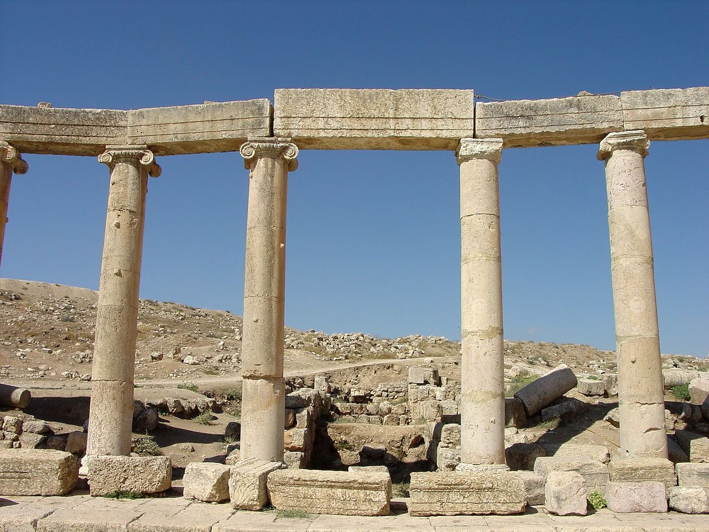

# 安曼手记

一份按生活半径画的安曼指南，再往外是一张约旦全域的出行清单。

*城堡山上的赫拉克勒斯神庙，俯瞰安曼。照片：Mohammad hajeer（CC BY-SA 4.0）*

**在线看：https://jacknnnbauer.github.io/amman-notes/**

英文版介绍见 [README_EN.md](README_EN.md)。

## 为什么写这份指南

这不是游客攻略，是住在安曼的人按自己的生活半径画的图。

我的日常在七环一带：超市、五金店、中国超市；周末往外走，是城堡山、老城小吃、韦布德山的咖啡馆；再往外，是整个约旦——北边的罗马古城和森林，西边的死海和约旦河谷，沿国王公路南下是城堡与峡谷，最南端是佩特拉、瓦迪拉姆和红海。

所以这份指南的顺序也是这个顺序：**先是每天生活的那几条街，再是值得带朋友去的地方，最后是能直接出发的路线。**

## 里面有什么

### 01 · 安曼地图

一张可以拖动的安曼示意地图：扎赫兰街串起一环到八环，城市沿着山头铺开。**50 个地点**，点任意一个点看介绍；按分类筛选；一键跳到老城 · 韦布德山、七环 · 苏韦菲耶、北区 · 约旦大学。

### 02 · 安曼地点详情

我的日常补给站，值得带朋友去的景点，口碑好的餐厅、咖啡馆和有意思的去处。支持搜索——搜地点、菜名或街区，比如 `Mansaf`、韦布德。每张卡片都能在本页地图上定位，或直接打开 Google 地图。

*彩虹街，韦布德山一带最热闹的步行街。照片：Producer（CC BY-SA 3.0）*

### 03 · 约旦值得去的地方

**14 个目的地**，每个都有看点、距安曼的距离、车程、建议时长和实用提示。北边是杰拉什、阿杰隆，南边是佩特拉、瓦迪拉姆、亚喀巴，中间是死海、穆吉布峡谷和国王公路上的城堡。

| 杰拉什 · 椭圆广场 | 死海 |
| --- | --- |
|  |  |
| 中东保存最完整的罗马城市之一，柱廊大街绵延约 800 米 | 地球表面最低点，湖水含盐量极高，人能浮在水面上 |

| 佩特拉 · 卡兹尼神殿 | 瓦迪拉姆 |
| --- | --- |
|  |  |
| 玫瑰红岩壁上凿出的宝库，约旦最出名的那张脸 | 火星一样的红色沙漠，夜里星空极清 |

### 04 · 目的地与路线

每个目的地的详细介绍后面，是 5 条从安曼出发的现成路线，拿起来就能走：

| 路线 | 怎么走 |
| --- | --- |
| 北部古城一日 | 杰拉什 + 阿杰隆城堡，同一天 |
| 马赛克与死海一日 | 马德巴马赛克 + 尼波山 + 死海漂浮 |
| 萨尔特半日 | 老城石屋与山顶日落，半天往返 |
| 沙漠城堡一日 | 东部沙漠城堡环线 |
| 南线经典 4–5 天 | 国王公路南下：卡拉克、佩特拉、瓦迪拉姆、亚喀巴 |

距离和车程从安曼市区算起，均为大约值。

## 什么时候去

| 季节 | 怎么样 |
| --- | --- |
| 3–5 月 · 春 | 全国最舒服，北部山花开，适合徒步和古城 |
| 6–8 月 · 夏 | 死海、亚喀巴和南部沙漠酷热，北部高地和穆吉布溯溪相对合适 |
| 9–11 月 · 秋 | 出行好时节，佩特拉和瓦迪拉姆白天温和，夜里开始变冷 |
| 12–2 月 · 冬 | 安曼、佩特拉、达纳冷，偶尔下雪；死海和亚喀巴反而暖和 |

## 适合谁

- **住在安曼的人**：七环、超市、五金店这些日常地点都标出来了，找东西不用再问人
- **要来安曼的朋友**：按这份指南走一圈，老城、彩虹街、城堡山就都认得了
- **想自驾约旦的人**：14 个目的地 + 5 条路线，车程和时长都写好了，直接排进行程

## 怎么用

单个 HTML 文件，打开即用，不用安装、不用部署（字体从 Google Fonts 加载）。中文、英文、阿拉伯语三语切换（阿拉伯语自动右向排版），支持深色模式，手机上也能用。

## 注意

地图为示意图。提供过地图链接的地点位置准确，其余地点为大致位置，出发前以 Google 地图为准。餐厅与咖啡馆的营业状态会变化。

资料：餐厅获奖信息来自 MENA's 50 Best Restaurants 2025（[Hyphen 报道](https://hyphenonline.com/2025/06/17/jordan-amman-fine-dining-mena-50-best-restaurants-alee-dara-dining-sufra/)）；安曼道路与环岛参考 [Wikipedia](https://en.wikipedia.org/wiki/List_of_roads_in_Amman)。

## 图片来源

本页照片来自 [Wikimedia Commons](https://commons.wikimedia.org/)，均为自由许可，感谢摄影师：

- 城堡山赫拉克勒斯神庙：Mohammad hajeer（CC BY-SA 4.0）
- 彩虹街：Producer（CC BY-SA 3.0）
- 杰拉什椭圆广场：G41rn8（CC BY-SA 3.0）
- 死海：Bernard Gagnon（CC BY-SA 3.0）
- 佩特拉卡兹尼神殿：Vyacheslav Argenberg（CC BY 4.0）
- 瓦迪拉姆：Vyacheslav Argenberg（CC BY 4.0）

## License

MIT
