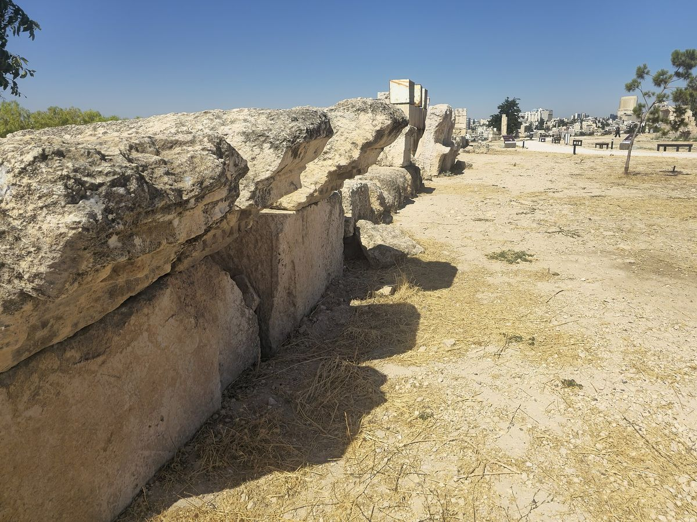
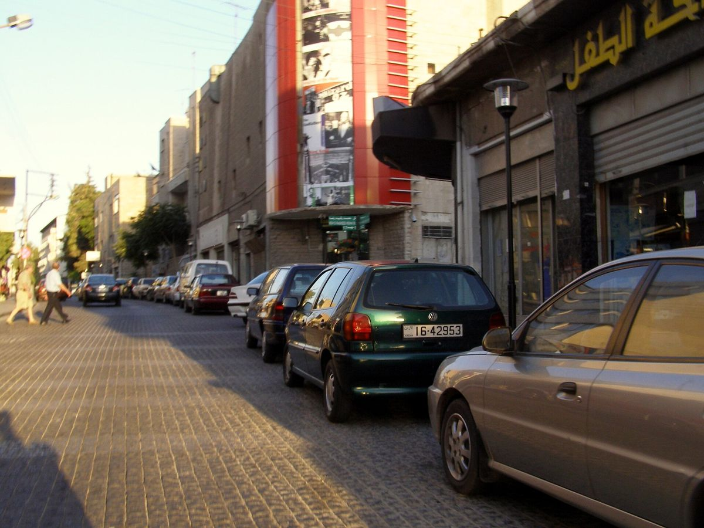
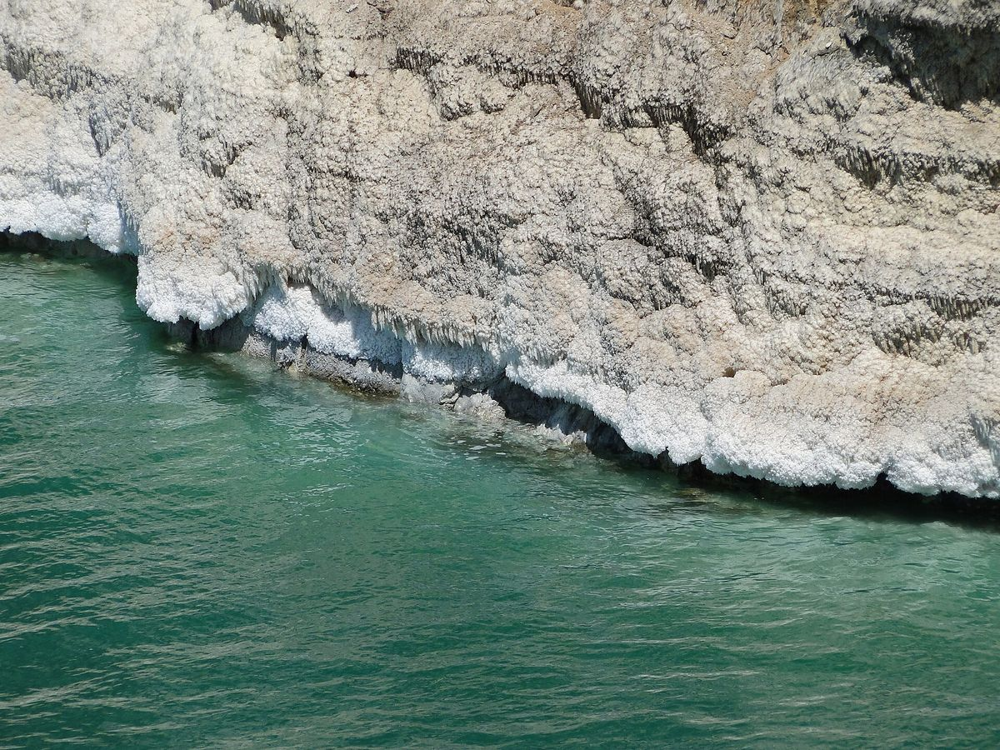
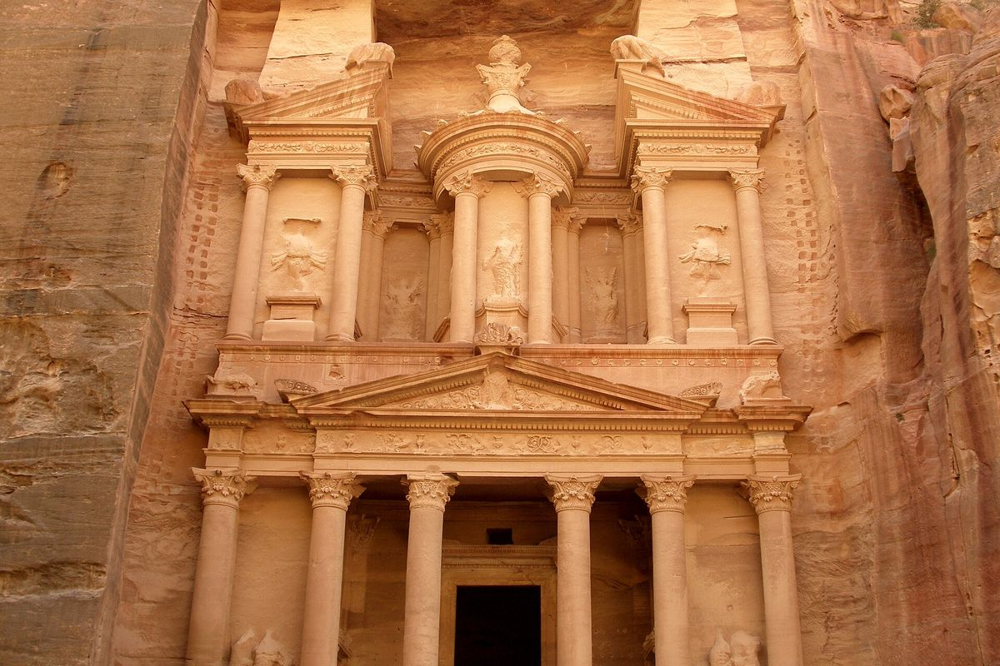
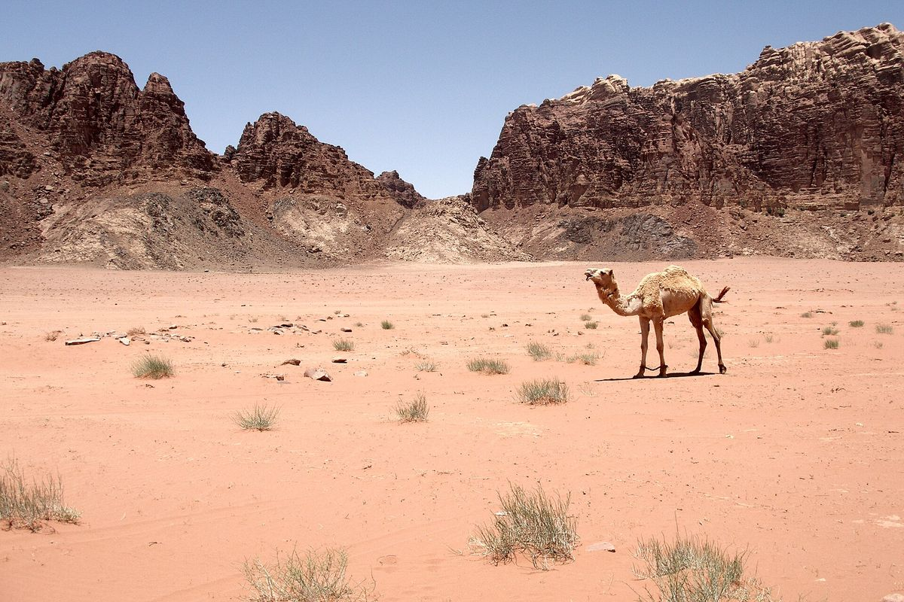
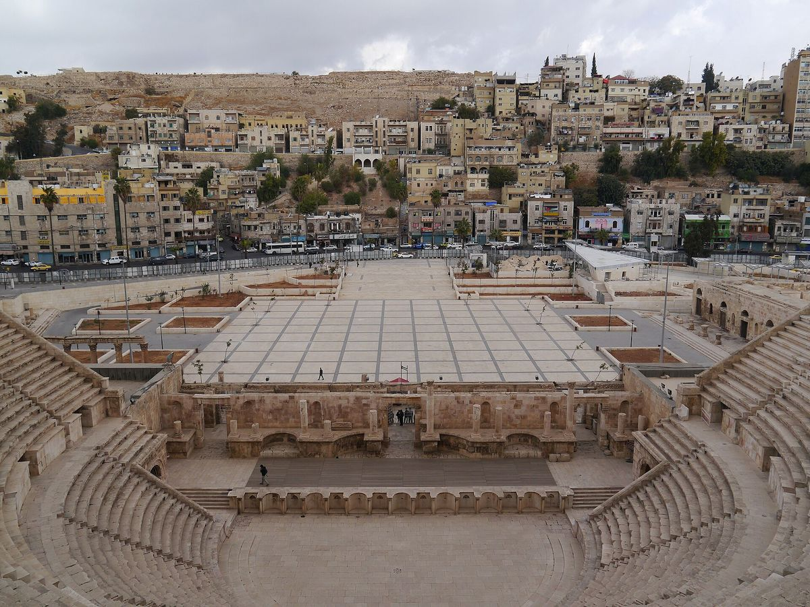

# 安曼手记

一份按生活半径画的安曼指南，再往外是一张约旦全域的出行清单。

*城堡山上的赫拉克勒斯神庙，俯瞰安曼。照片：Mohammad hajeer（CC BY-SA 4.0）*

**在线看：https://jacknnnbauer.github.io/amman-notes/**

英文版介绍见 [README_EN.md](README_EN.md)。

## 为什么写这份指南

这不是游客攻略，是住在安曼的人按自己的生活半径画的图。

我的日常在七环一带：超市、五金店、中国超市；周末往外走，是城堡山、老城小吃、韦布德山的咖啡馆；再往外，是整个约旦——北边的罗马古城和森林，西边的死海和约旦河谷，沿国王公路南下是城堡与峡谷，最南端是佩特拉、瓦迪拉姆和红海。

所以这份指南的顺序也是这个顺序：**先是每天生活的那几条街，再是值得带朋友去的地方，最后是能直接出发的路线。**

## 安曼这座城市

安曼是一座建在山头上的城市：七座山丘（jabal）起伏，房子顺着坡面铺开，清一色的白色石灰岩外墙，阳光下整座城泛着米白色。扎赫兰街串起一环到八环，环岛就是这里的路标——跟人约地方，说“七环”比说街名管用。

城市海拔约 800 米，夏天干爽、晚上凉快，冬天会冷、偶尔下雪。老城在东边低处，新区在西边高处，从城堡山上能一眼看全。

## 里面有什么

### 01 · 安曼地图

一张可以拖动的安曼示意地图：扎赫兰街串起一环到八环，城市沿着山头铺开。**50 个地点**，点任意一个点看介绍；按分类筛选（我的常去、景点、餐厅、咖啡馆、有意思的去处）；一键跳到老城 · 韦布德山、七环 · 苏韦菲耶、北区 · 约旦大学。

### 02 · 安曼地点详情

我的日常补给站，值得带朋友去的景点，口碑好的餐厅、咖啡馆和有意思的去处。支持搜索——搜地点、菜名或街区，比如 `Mansaf`、韦布德。每张卡片都能在本页地图上定位，或直接打开 Google 地图。

*彩虹街，韦布德山一带最热闹的步行街。照片：Producer（CC BY-SA 3.0）*

### 03 · 约旦值得去的地方

**14 个目的地**，每个都有看点、距安曼的距离、车程、建议时长和实用提示。北边是杰拉什、阿杰隆，南边是佩特拉、瓦迪拉姆、亚喀巴，中间是死海、穆吉布峡谷和国王公路上的城堡。

| 杰拉什 · 椭圆广场 | 死海 |
| --- | --- |
|  |  |
| 中东保存最完整的罗马城市之一，柱廊大街绵延约 800 米 | 地球表面最低点，湖水含盐量极高，人能浮在水面上 |

| 佩特拉 · 卡兹尼神殿 | 瓦迪拉姆 |
| --- | --- |
|  |  |
| 玫瑰红岩壁上凿出的宝库，约旦最出名的那张脸 | 火星一样的红色沙漠，夜里星空极清 |

### 04 · 目的地与路线

每个目的地的详细介绍后面，是 5 条从安曼出发的现成路线，拿起来就能走：

| 路线 | 怎么走 |
| --- | --- |
| 北部古城一日 | 杰拉什 + 阿杰隆城堡，同一天 |
| 马赛克与死海一日 | 马德巴马赛克 + 尼波山 + 死海漂浮 |
| 萨尔特半日 | 老城石屋与山顶日落，半天往返 |
| 沙漠城堡一日 | 东部沙漠城堡环线 |
| 南线经典 4–5 天 | 国王公路南下：卡拉克、佩特拉、瓦迪拉姆、亚喀巴 |

距离和车程从安曼市区算起，均为大约值。

## 第一次来安曼：第一天这样走

只留一天给安曼，按这条线走，城市的三个面就都看到了：

*罗马剧场，藏在老城市中心的古罗马遗迹。照片：Zairon（CC BY-SA 3.0）*

- **上午 · 城堡山**：先上城堡山（Jabal al-Qal'a），赫拉克勒斯神庙的石柱 + 俯瞰全城，2 小时。山下就是约旦博物馆，死海古卷残片和约 9000 年前的艾因加扎尔石灰塑像都在这里，去佩特拉、杰拉什之前先来补课。
- **中午 · 老城**：下山走进老城（Al-Balad），罗马剧场就在市中心。午饭去 Hashem 吃当地小吃，旁边就是卖甜点的 Habibah。
- **下午 · 彩虹街**：打车上韦布德山，彩虹街慢慢逛，Sufra、Shams El Balad 这些餐厅都在这一带，Darat al Funun 艺术区和约旦国家美术馆也值得顺路看。
- **傍晚 · 韦布德山**：找家咖啡馆（Rumi Café、Books@Café）坐下来，看太阳落到山丘后面。

## 我的常去

住在安曼的人，日常就是这几个地方：

| 地方 | 是什么 |
| --- | --- |
| 七环 | 每天活动的中心，超市和办事都在这一带 |
| Safeway · Cozmo | 七圈两家大超市，日常补给 |
| Silk Road 中国超市 | 花园街，想吃中餐、买中国调料去这里 |
| % Arabica | Sweifieh Village 的咖啡，提神 |
| Bambooba | 约旦大学附近的中餐厅，火锅、牛肉面、珍珠奶茶 |
| 华村 | 六环与七环之间，同事聚餐、请客吃中餐都方便 |
| 茶餐厅 | 约旦大学附近，大学路一带，想吃一顿简单的中式饭菜 |

## 约旦 14 个目的地一览

从安曼出发，全表都在这里：

| 目的地 | 距安曼 | 车程 | 建议时长 | 最佳时间 | 一句话 |
| --- | --- | --- | --- | --- | --- |
| 杰拉什 | 约 50 km | 约 1 小时 | 3–4 小时 | 春秋；上午人少 | 中东保存最完整的罗马城市之一，柱廊大街和椭圆广场气势惊人 |
| 阿杰隆 | 约 75 km | 约 1.5 小时 | 2–3 小时 | 春季山花、秋季 | 萨拉丁时代的山顶城堡，加上约旦少见的橡树森林 |
| 乌姆盖斯 | 约 110 km | 约 2 小时 | 2–3 小时 | 傍晚看日落 | 黑色玄武岩的十城联盟古城，俯瞰加利利海和戈兰高地 |
| 萨尔特 | 约 30 km | 约 45 分钟 | 半天 | 全年 | 依山而建的黄色石灰岩老城，2021 年列入世界遗产 |
| 马达巴 · 尼波山 | 约 35 km | 约 45 分钟 | 半天 | 全年 | “马赛克之城”和传说中摩西眺望应许之地的山头 |
| 约旦河洗礼处 | 约 50 km | 约 1 小时 | 2–3 小时 | 秋冬春；夏天很热 | 传统认为是施洗约翰为耶稣施洗的地方，2015 年列入世界遗产 |
| 死海 | 约 55 km | 约 1 小时 | 半天到一晚 | 10–4 月最舒服 | 海拔约 −430 米，地表最低点，人可以浮在水面上 |
| 穆吉布峡谷 | 约 85 km | 约 1.5 小时 | 2–4 小时 | 约 4–10 月开放 | 世界海拔最低的自然保护区，在红色峡谷里溯溪而上 |
| 卡拉克城堡 | 约 125 km | 约 2 小时 | 1.5–2 小时 | 全年 | 12 世纪的十字军城堡，后经马穆鲁克扩建，地下拱廊错综复杂 |
| 达纳 · 肖巴克 | 约 200 km | 约 3 小时 | 1–2 天 | 春秋 | 约旦最大的自然保护区，加上一座孤立山头上的十字军城堡 |
| 佩特拉 | 约 235 km | 约 3 小时 | 1–2 天 | 春秋 | 纳巴泰人在玫瑰色砂岩里凿出的城市，约旦最值得去的地方 |
| 瓦迪拉姆 | 约 320 km | 约 4 小时 | 1–2 天（住一晚营地） | 秋冬春 | 红色沙漠和砂岩山，世界自然与文化双遗产 |
| 亚喀巴 | 约 330 km | 约 4 小时，或飞约 1 小时 | 1–3 天 | 11–3 月最舒服 | 约旦唯一的出海口，红海珊瑚礁就在岸边 |
| 东部沙漠城堡 | 约 60–100 km | 环线约 1 天 | 1 天 | 秋冬春 | 7–8 世纪倭马亚王朝留在沙漠里的宫殿和堡垒 |

## 什么时候去

| 季节 | 怎么样 |
| --- | --- |
| 3–5 月 · 春 | 全国最舒服，北部山花开，适合徒步和古城 |
| 6–8 月 · 夏 | 死海、亚喀巴和南部沙漠酷热，北部高地和穆吉布溯溪相对合适 |
| 9–11 月 · 秋 | 出行好时节，佩特拉和瓦迪拉姆白天温和，夜里开始变冷 |
| 12–2 月 · 冬 | 安曼、佩特拉、达纳冷，偶尔下雪；死海和亚喀巴反而暖和 |

## 实用信息

- **货币**：约旦第纳尔（JOD），与美元挂钩，1 美元约兑 0.709 第纳尔；商场和餐厅多可刷卡，市集和打车备点现金
- **语言**：阿拉伯语，英语在安曼通用，景点、酒店、餐厅基本能用英语沟通
- **时区**：UTC+3，比北京晚 5 小时
- **周末**：周五、周六（周日是工作日）
- **水**：自来水不建议直饮，买瓶装水

## 适合谁

- **住在安曼的人**：七环、超市、五金店这些日常地点都标出来了，找东西不用再问人
- **要来安曼的朋友**：按这份指南走一圈，老城、彩虹街、城堡山就都认得了
- **想自驾约旦的人**：14 个目的地 + 5 条路线，车程和时长都写好了，直接排进行程

## 怎么用

单个 HTML 文件，打开即用，不用安装、不用部署（字体从 Google Fonts 加载）。中文、英文、阿拉伯语三语切换（阿拉伯语自动右向排版），支持深色模式，手机上也能用。

## 注意

地图为示意图。提供过地图链接的地点位置准确，其余地点为大致位置，出发前以 Google 地图为准。餐厅与咖啡馆的营业状态会变化。

资料：餐厅获奖信息来自 MENA's 50 Best Restaurants 2025（[Hyphen 报道](https://hyphenonline.com/2025/06/17/jordan-amman-fine-dining-mena-50-best-restaurants-alee-dara-dining-sufra/)）；安曼道路与环岛参考 [Wikipedia](https://en.wikipedia.org/wiki/List_of_roads_in_Amman)。

## 图片来源

本页照片来自 [Wikimedia Commons](https://commons.wikimedia.org/)，均为自由许可，感谢摄影师：

- 城堡山赫拉克勒斯神庙：Mohammad hajeer（CC BY-SA 4.0）
- 彩虹街：Producer（CC BY-SA 3.0）
- 罗马剧场：Zairon（CC BY-SA 3.0）
- 杰拉什椭圆广场：G41rn8（CC BY-SA 3.0）
- 死海：Bernard Gagnon（CC BY-SA 3.0）
- 佩特拉卡兹尼神殿：Vyacheslav Argenberg（CC BY 4.0）
- 瓦迪拉姆：Vyacheslav Argenberg（CC BY 4.0）

## License

MIT
