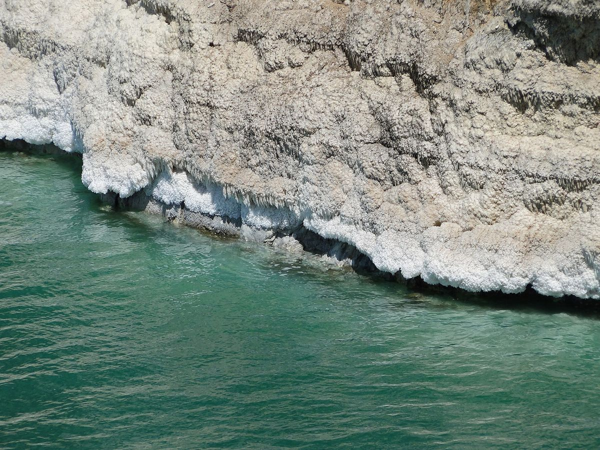
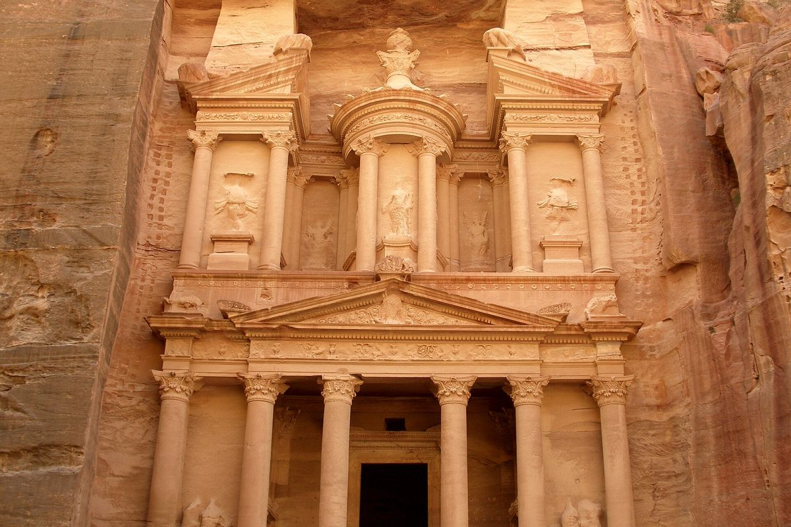

# Amman Notes

A personal guide to Amman, drawn around daily life — and beyond it, a travel list for the whole of Jordan.

*The Temple of Hercules on the Citadel, overlooking Amman. Photo: Mohammad hajeer (CC BY-SA 4.0)*

**View online: https://jacknnnbauer.github.io/amman-notes/**

中文版介绍见 [README.md](README.md)。

## Why this guide exists

This is not a tourist brochure. It is a map drawn by someone who lives in Amman, around the radius of his own daily life.

My days run around the 7th Circle: supermarkets, hardware stores, the Chinese supermarket. Weekends stretch further out — the Citadel, Downtown snacks, the cafés of Jabal Al-Weibdeh. And beyond that, the whole of Jordan: Roman cities and forests to the north, the Dead Sea and the Jordan Valley to the west, castles and canyons down the King's Highway, and Petra, Wadi Rum and the Red Sea at the far south.

So the guide follows that same order: **first the streets of everyday life, then the places worth taking friends to, then routes you can set off on right away.**

## What's inside

### 01 · Amman map

A draggable schematic map of Amman: Zahran Street strings the 1st to the 8th Circles together, and the city spreads over the hills. **50 places** — tap any pin for details, filter by category, or jump straight to Downtown · Jabal Al-Weibdeh, 7th Circle · Sweifieh, or North · University of Jordan.

### 02 · Amman places

My daily supply stops, sights worth taking friends to, and well-reviewed restaurants, cafés and interesting spots. Search by place, dish or neighbourhood — try `Mansaf` or Weibdeh. Every card can be located on the map above or opened in Google Maps.

*Rainbow Street, the liveliest walking street around Jabal Amman. Photo: Producer (CC BY-SA 3.0)*

### 03 · Places worth visiting in Jordan

**14 destinations**, each with highlights, distance from Amman, drive time, suggested duration and practical tips. Jerash and Ajloun in the north, Petra, Wadi Rum and Aqaba in the south, and the Dead Sea, the Mujib canyon and the King's Highway castles in between.

| Jerash · Oval Plaza | Dead Sea |
| --- | --- |
|  |  |
| One of the best-preserved Roman cities in the Middle East, its colonnaded street running about 800 m | The lowest point on Earth — the water is so salty you float |

| Petra · The Treasury | Wadi Rum |
| --- | --- |
|  |  |
| The Treasury carved into rose-red rock — the most famous face in Jordan | A Mars-like red desert, with some of the clearest night skies anywhere |

### 04 · Destinations & routes

After the destination details come 5 ready-made routes from Amman — pick one and go:

| Route | How it runs |
| --- | --- |
| Northern ruins in a day | Jerash + Ajloun Castle, same day |
| Mosaics & Dead Sea in a day | Madaba mosaics + Mount Nebo + a float in the Dead Sea |
| Salt in half a day | Old stone houses and a hilltop sunset, there and back in half a day |
| Desert castles in a day | The eastern desert castles loop |
| Classic southern loop, 4–5 days | Down the King's Highway: Karak, Petra, Wadi Rum, Aqaba |

Distances and drive times are from central Amman and are approximate.

## When to go

| Season | What it's like |
| --- | --- |
| Mar–May · Spring | The most comfortable season nationwide; wildflowers bloom in the northern hills — good for hiking and ancient cities |
| Jun–Aug · Summer | The Dead Sea, Aqaba and the southern desert are scorching; the northern highlands and the Mujib canyon are relatively better |
| Sep–Nov · Autumn | A great season for travelling: mild days in Petra and Wadi Rum, with nights turning cold |
| Dec–Feb · Winter | Amman, Petra and Dana are cold, with occasional snow; the Dead Sea and Aqaba are warm instead |

## Who it's for

- **People living in Amman**: the everyday places — 7th Circle, supermarkets, hardware stores — are all marked, so you stop having to ask around
- **Friends coming to visit**: follow this guide and you'll know Downtown, Rainbow Street and the Citadel in a day or two
- **Anyone driving around Jordan**: 14 destinations + 5 routes, with drive times and durations written out, ready to drop into an itinerary

## How to use it

A single HTML file — open it and it works, no install, no build step (fonts load from Google Fonts). Chinese, English and Arabic with one switch (Arabic flips to right-to-left automatically). Dark mode supported, works on phones.

## Note

The map is schematic. Places with a map link I provided are placed accurately; the rest are approximate — check Google Maps before you go. Restaurant and café hours change.

Sources: restaurant award information from MENA's 50 Best Restaurants 2025 ([Hyphen report](https://hyphenonline.com/2025/06/17/jordan-amman-fine-dining-mena-50-best-restaurants-alee-dara-dining-sufra/)); Amman roads and circles from [Wikipedia](https://en.wikipedia.org/wiki/List_of_roads_in_Amman).

## Photo credits

Photos on this page are from [Wikimedia Commons](https://commons.wikimedia.org/), all freely licensed — thanks to the photographers:

- Temple of Hercules, Citadel: Mohammad hajeer (CC BY-SA 4.0)
- Rainbow Street: Producer (CC BY-SA 3.0)
- Oval Plaza, Jerash: G41rn8 (CC BY-SA 3.0)
- Dead Sea: Bernard Gagnon (CC BY-SA 3.0)
- The Treasury, Petra: Vyacheslav Argenberg (CC BY 4.0)
- Wadi Rum: Vyacheslav Argenberg (CC BY 4.0)

## License

MIT
