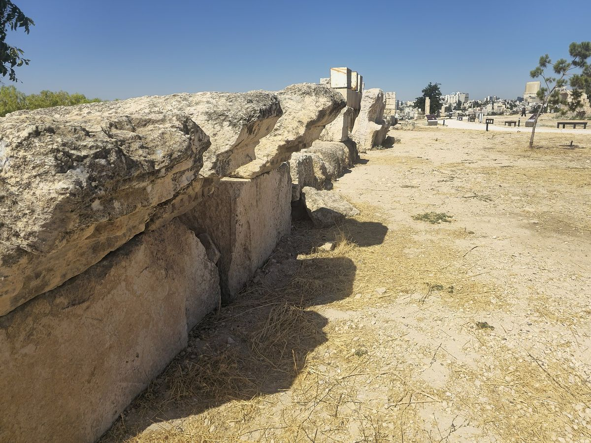
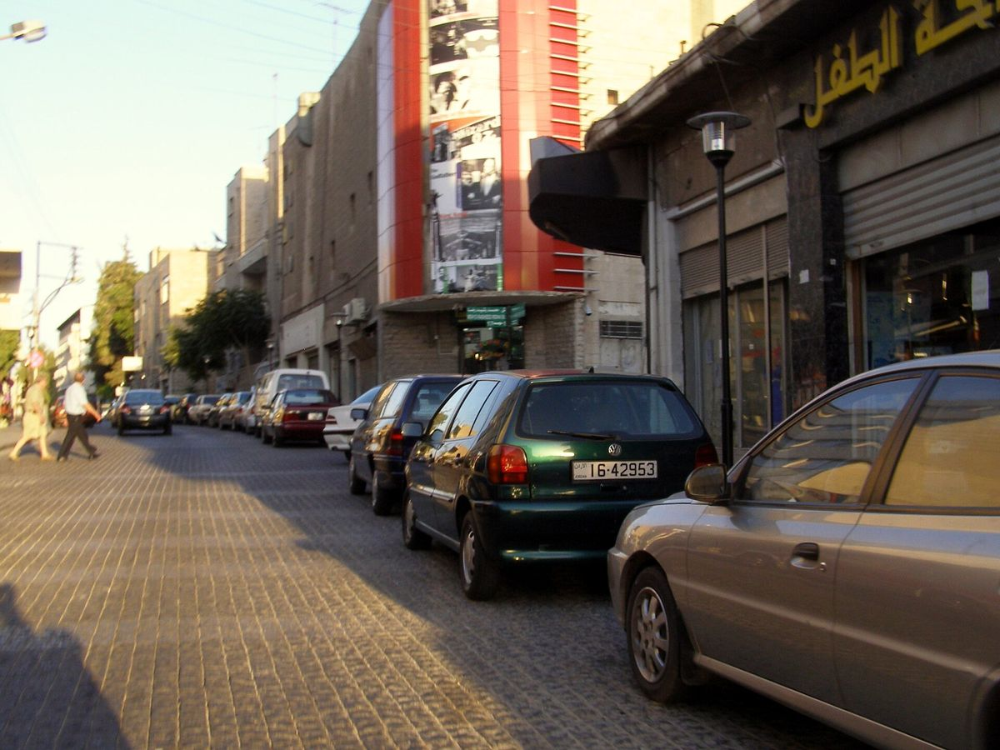
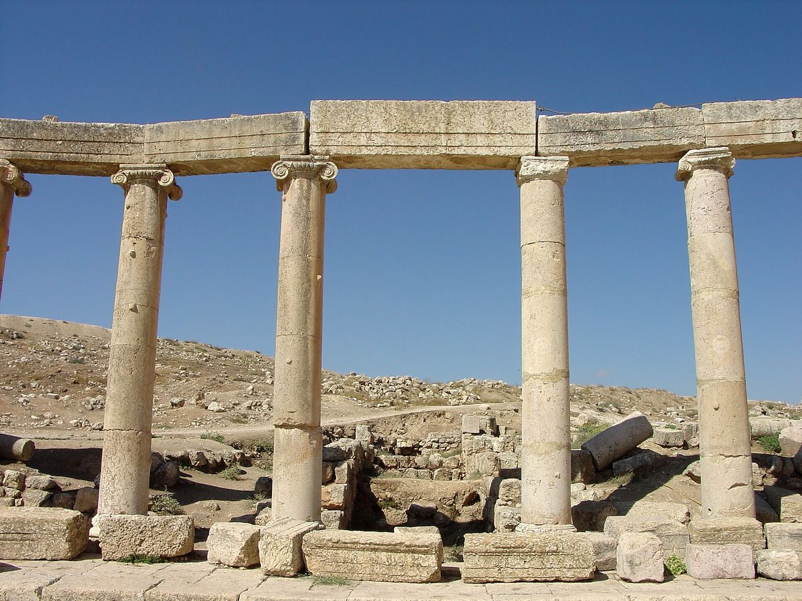
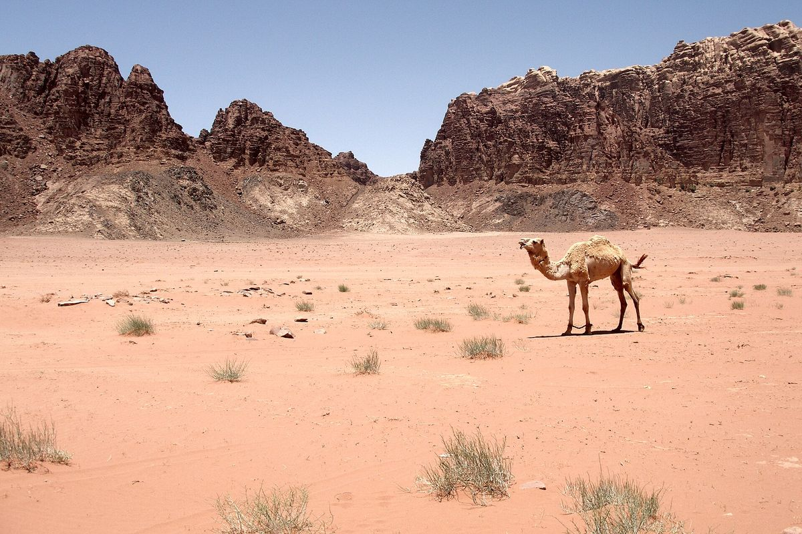
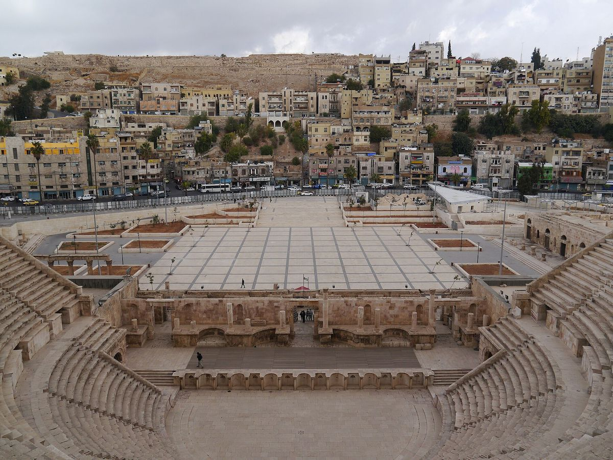

# Amman Notes

A personal guide to Amman, drawn around daily life — and beyond it, a travel list for the whole of Jordan.

*The Temple of Hercules on the Citadel, overlooking Amman. Photo: Mohammad hajeer (CC BY-SA 4.0)*

**View online: https://jacknnnbauer.github.io/amman-notes/**

中文版介绍见 [README.md](README.md)。

## Why this guide exists

This is not a tourist brochure. It is a map drawn by someone who lives in Amman, around the radius of his own daily life.

My days run around the 7th Circle: supermarkets, hardware stores, the Chinese supermarket. Weekends stretch further out — the Citadel, Downtown snacks, the cafés of Jabal Al-Weibdeh. And beyond that, the whole of Jordan: Roman cities and forests to the north, the Dead Sea and the Jordan Valley to the west, castles and canyons down the King's Highway, and Petra, Wadi Rum and the Red Sea at the far south.

So the guide follows that same order: **first the streets of everyday life, then the places worth taking friends to, then routes you can set off on right away.**

## The city of Amman

Amman is a city built on hills: seven jabals rising and falling, houses climbing the slopes, all in the same white limestone, so the whole city glows off-white in the sun. Zahran Street strings the 1st to the 8th Circles together, and the circles are the landmarks people actually navigate by — "7th Circle" works better than a street name.

The city sits at about 800 metres above sea level: dry summers with cool evenings, cold winters with the occasional snow. Downtown sits low in the east, the newer districts high in the west, and from the Citadel you can see all of it at once.

## What's inside

### 01 · Amman map

A draggable schematic map of Amman: Zahran Street strings the 1st to the 8th Circles together, and the city spreads over the hills. **50 places** — tap any pin for details, filter by category (my regulars, sights, restaurants, cafés, interesting spots), or jump straight to Downtown · Jabal Al-Weibdeh, 7th Circle · Sweifieh, or North · University of Jordan.

### 02 · Amman places

My daily supply stops, sights worth taking friends to, and well-reviewed restaurants, cafés and interesting spots. Search by place, dish or neighbourhood — try `Mansaf` or Weibdeh. Every card can be located on the map above or opened in Google Maps.

*Rainbow Street, the liveliest walking street around Jabal Amman. Photo: Producer (CC BY-SA 3.0)*

### 03 · Places worth visiting in Jordan

**14 destinations**, each with highlights, distance from Amman, drive time, suggested duration and practical tips. Jerash and Ajloun in the north, Petra, Wadi Rum and Aqaba in the south, and the Dead Sea, the Mujib canyon and the King's Highway castles in between.

| Jerash · Oval Plaza | Dead Sea |
| --- | --- |
|  |  |
| One of the best-preserved Roman cities in the Middle East, its colonnaded street running about 800 m | The lowest point on Earth — the water is so salty you float |

| Petra · The Treasury | Wadi Rum |
| --- | --- |
|  |  |
| The Treasury carved into rose-red rock — the most famous face in Jordan | A Mars-like red desert, with some of the clearest night skies anywhere |

### 04 · Destinations & routes

After the destination details come 5 ready-made routes from Amman — pick one and go:

| Route | How it runs |
| --- | --- |
| Northern ruins in a day | Jerash + Ajloun Castle, same day |
| Mosaics & Dead Sea in a day | Madaba mosaics + Mount Nebo + a float in the Dead Sea |
| Salt in half a day | Old stone houses and a hilltop sunset, there and back in half a day |
| Desert castles in a day | The eastern desert castles loop |
| Classic southern loop, 4–5 days | Down the King's Highway: Karak, Petra, Wadi Rum, Aqaba |

Distances and drive times are from central Amman and are approximate.

## First time in Amman: one day, done right

If you only have one day for Amman, walk this line and you'll see all three faces of the city:

*The Roman Theatre, in the middle of Downtown. Photo: Zairon (CC BY-SA 3.0)*

- **Morning · the Citadel**: start on Jabal al-Qal'a — the columns of the Temple of Hercules and the whole city below, about 2 hours. Just below it is The Jordan Museum, home to Dead Sea Scrolls fragments and the 9,000-year-old Ain Ghazal statues — a good primer before Petra or Jerash.
- **Midday · Downtown**: walk down into Al-Balad, the old city, where the Roman Theatre sits in the middle of town. Lunch at Hashem for local snacks, with Habibah sweets next door.
- **Afternoon · Rainbow Street**: head up to Jabal Al-Weibdeh and wander Rainbow Street — Sufra and Shams El Balad are here, and Darat al Funun and the Jordan National Gallery of Fine Arts are worth a detour.
- **Evening · Jabal Al-Weibdeh**: pick a café (Rumi Café, Books@Café) and watch the sun drop behind the hills.

## My regulars

For someone living in Amman, daily life is these places:

| Place | What it is |
| --- | --- |
| 7th Circle | The centre of my daily life — supermarkets and errands all happen around here |
| Safeway · Cozmo | The two big supermarkets at the 7th Circle, for daily supplies |
| Silk Road Chinese Supermarket | On Wasfi Al-Tal St — Chinese food and seasonings when you miss home |
| % Arabica | Coffee at Sweifieh Village, for a pick-me-up |
| Bambooba | Chinese restaurant near the University of Jordan — hotpot, beef noodles, bubble tea |
| Chinese Village | Between the 6th and 7th Circles — good for a group dinner or treating colleagues to Chinese food |
| Tea House | Near the University of Jordan, on University Road — a simple Chinese meal |

## All 14 Jordan destinations at a glance

From Amman, the whole list:

| Destination | From Amman | Drive | Suggested stay | Best time | In one line |
| --- | --- | --- | --- | --- | --- |
| Jerash | approx. 50 km | about 1 hour | 3–4 hours | Spring and autumn; quieter in the morning | One of the best-preserved Roman cities in the Middle East — colonnaded street and Oval Plaza |
| Ajloun | approx. 75 km | about 1.5 hours | 2–3 hours | Spring wildflowers, autumn | A Saladin-era hilltop castle, plus oak forest rare for Jordan |
| Umm Qais | approx. 110 km | about 2 hours | 2–3 hours | Sunset | A black-basalt Decapolis city looking over the Sea of Galilee and the Golan Heights |
| As-Salt | approx. 30 km | about 45 minutes | Half a day | All year | A yellow-limestone old town built into the hills, UNESCO-listed in 2021 |
| Madaba · Mount Nebo | approx. 35 km | about 45 minutes | Half a day | All year | The "City of Mosaics" and the hill where Moses is said to have looked over the Promised Land |
| Bethany beyond the Jordan | approx. 50 km | about 1 hour | 2–3 hours | Autumn, winter, spring; very hot in summer | Traditionally the place where John baptized Jesus, UNESCO-listed in 2015 |
| Dead Sea | approx. 55 km | about 1 hour | Half a day to a night | Most comfortable Oct–Apr | About −430 m, the lowest point on Earth — you float |
| Wadi Mujib | approx. 85 km | about 1.5 hours | 2–4 hours | Open about Apr–Oct | The world's lowest nature reserve — wade up a red canyon |
| Karak Castle | approx. 125 km | about 2 hours | 1.5–2 hours | All year | A 12th-century Crusader castle, later expanded by the Mamluks, with maze-like vaulted passages |
| Dana · Shobak | approx. 200 km | about 3 hours | 1–2 days | Spring and autumn | Jordan's largest nature reserve, plus a Crusader castle on an isolated hill |
| Petra | approx. 235 km | about 3 hours | 1–2 days | Spring and autumn | A Nabataean city carved into rose sandstone — the one place in Jordan you must see |
| Wadi Rum | approx. 320 km | about 4 hours | 1–2 days (sleep one night in camp) | Autumn, winter, spring | Red desert and sandstone mountains, a UNESCO natural and cultural site |
| Aqaba | approx. 330 km | about 4 hours, or about 1 hour by air | 1–3 days | Most comfortable Nov–Mar | Jordan's only seaport — Red Sea coral reefs right off the shore |
| Desert Castles · Azraq | approx. 60–100 km | Loop about 1 day | 1 day | Autumn, winter, spring | 7th–8th century Umayyad palaces and forts left in the desert |

## When to go

| Season | What it's like |
| --- | --- |
| Mar–May · Spring | The most comfortable season nationwide; wildflowers bloom in the northern hills — good for hiking and ancient cities |
| Jun–Aug · Summer | The Dead Sea, Aqaba and the southern desert are scorching; the northern highlands and the Mujib canyon are relatively better |
| Sep–Nov · Autumn | A great season for travelling: mild days in Petra and Wadi Rum, with nights turning cold |
| Dec–Feb · Winter | Amman, Petra and Dana are cold, with occasional snow; the Dead Sea and Aqaba are warm instead |

## Practical information

- **Currency**: Jordanian dinar (JOD), pegged to the US dollar — about 0.709 per dollar. Cards work in malls and restaurants; keep cash for markets and taxis
- **Language**: Arabic; English is widely spoken in Amman — sights, hotels and restaurants are fine in English
- **Time zone**: UTC+3, five hours behind Beijing
- **Weekend**: Friday and Saturday (Sunday is a working day)
- **Water**: don't drink the tap water — buy bottled

## Who it's for

- **People living in Amman**: the everyday places — 7th Circle, supermarkets, hardware stores — are all marked, so you stop having to ask around
- **Friends coming to visit**: follow this guide and you'll know Downtown, Rainbow Street and the Citadel in a day or two
- **Anyone driving around Jordan**: 14 destinations + 5 routes, with drive times and durations written out, ready to drop into an itinerary

## How to use it

A single HTML file — open it and it works, no install, no build step (fonts load from Google Fonts). Chinese, English and Arabic with one switch (Arabic flips to right-to-left automatically). Dark mode supported, works on phones.

## Note

The map is schematic. Places with a map link I provided are placed accurately; the rest are approximate — check Google Maps before you go. Restaurant and café hours change.

Sources: restaurant award information from MENA's 50 Best Restaurants 2025 ([Hyphen report](https://hyphenonline.com/2025/06/17/jordan-amman-fine-dining-mena-50-best-restaurants-alee-dara-dining-sufra/)); Amman roads and circles from [Wikipedia](https://en.wikipedia.org/wiki/List_of_roads_in_Amman).

## Photo credits

Photos on this page are from [Wikimedia Commons](https://commons.wikimedia.org/), all freely licensed — thanks to the photographers:

- Temple of Hercules, Citadel: Mohammad hajeer (CC BY-SA 4.0)
- Rainbow Street: Producer (CC BY-SA 3.0)
- Roman Theatre: Zairon (CC BY-SA 3.0)
- Oval Plaza, Jerash: G41rn8 (CC BY-SA 3.0)
- Dead Sea: Bernard Gagnon (CC BY-SA 3.0)
- The Treasury, Petra: Vyacheslav Argenberg (CC BY 4.0)
- Wadi Rum: Vyacheslav Argenberg (CC BY 4.0)

## License

MIT
